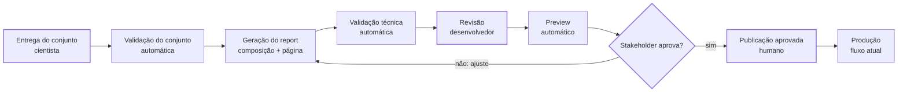

# PRD — Publicação automatizada de estudos

| | |
|---|---|
| **ID** | PRD-2026-001 |
| **Status** | Rascunho |
| **Versão** | 0.4 |
| **Responsável** | Mara |
| **Aprovadores** | Dalmolin |
| **Criado em** | 30/09/2026 |
| **Atualizado em** | 07/10/2026 |
| **Épico / issue** | A criar |
| **Relacionados** | PRDs: nenhum · ADRs (vigentes, índice em [adr/](adr/README.md)): [ADR-001](adr/ADR-001.md), [ADR-002](adr/ADR-002-entradas-do-estudo.md), [ADR-003](adr/ADR-003-estrutura-de-pastas.md), [ADR-004](adr/ADR-004-composicao-do-report.md), [ADR-005](adr/ADR-005-skills-do-agente.md) · Fluxo: [fluxo-da-esteira.md](fluxo-da-esteira.md) · Guia: [guia-de-preenchimento.md](guia-de-preenchimento.md) |

---

## 1. Problema

Cada estudo aprovado internamente passa por duas implementações manuais antes de chegar à produção. O fluxo atual é:

1. O cientista de dados concebe o estudo e faz a análise.
2. O cientista entrega ao desenvolvedor um conjunto de dados e orientações de como implementar o estudo.
3. O desenvolvedor implementa o estudo como uma página avulsa, fora do site.
4. A página avulsa é disponibilizada para validação.
5. Stakeholders não técnicos validam o resultado.
6. Após a aprovação, o desenvolvedor reconstrói o estudo dentro do site de estudos.
7. O desenvolvedor publica a mudança diretamente no ramo principal.
8. A publicação no ramo principal coloca o estudo em produção.

As dores observadas:

- **Trabalho duplicado.** O report é construído duas vezes. O próprio código do estudo publicado registra que foi convertido de uma página avulsa (comentário no componente do estudo, repositório graf-reports, lido em 30/09/2026).
- **O que foi aprovado não é o que vai ao ar.** Os stakeholders validam a página avulsa, não a publicada. Diferenças introduzidas na reconstrução chegam à produção sem nova validação.
- **Dependência total do desenvolvedor.** Interpretar o material do cientista e montar layout, gráficos e textos é manual e sem padrão de entrada. O tempo de publicação depende da disponibilidade de uma pessoa.
- **Sem padrão reutilizável.** Cores, tipografia, blocos visuais e gráficos do estudo publicado estão num único arquivo de 416 linhas, específico daquele estudo (fonte: repositório graf-reports, 30/09/2026). Um novo estudo tende a copiar esse arquivo, o que o ADR-001 quer evitar.
- **Publicação sem barreira.** A publicação no ramo principal vai para produção sem nenhuma checagem automática, e o ADR-001 exige validações para que um estudo não afete os demais.

Quem é afetado: desenvolvedores (esforço), cientistas de dados (espera e retrabalho de comunicação) e stakeholders (validam algo diferente do publicado). Frequência e custo por estudo ainda não foram medidos: há um estudo publicado até hoje (fonte: repositório), e o volume esperado está na Q20.

## 2. Objetivos e por que agora

**Objetivos**

- **O1.** Reduzir o trabalho manual do desenvolvedor entre o recebimento do estudo e a disponibilização para homologação.
- **O2.** Garantir que os stakeholders aprovem exatamente a versão que será publicada em produção.
- **O3.** Manter a consistência visual e técnica entre estudos e o isolamento entre eles, conforme o ADR-001.

**Por que agora**

Há um único estudo publicado e a arquitetura foi decidida há poucas semanas (ADR-001, ciência em 10/09/2026). É o momento mais barato para definir o padrão de entrada e o kit de componentes: cada novo estudo feito à mão antes disso aumenta o código específico a migrar depois e repete o ciclo de construir duas vezes. O volume de estudos previsto (Q20) define o custo real de adiar.

## 3. Usuários e papéis

| Papel | Quem | O que precisa | Como interage |
|---|---|---|---|
| Usuário principal | Cientista de dados | Entregar o estudo uma única vez, num formato que a automação consuma, e ver o resultado sem depender do desenvolvedor | Entrega o conjunto do estudo (dados, metodologia e guia de montagem); confere no preview se o report expressa a análise |
| Usuário principal | Desenvolvedor | Deixar de reimplementar cada estudo; manter o kit e as guidelines da plataforma; revisar o que foi gerado | Revisa a composição, o código e os componentes próprios gerados; evolui o kit |
| Usuário secundário | Stakeholder não técnico | Ver o report como ficará publicado e aprovar ou pedir ajustes sem ferramentas técnicas | Acessa um link de preview e registra aprovação ou pedidos de ajuste |
| Aprovador / decisor | A definir (Q16) | Decidir se o estudo pode ir para produção | Registra a aprovação que libera a publicação |
| Sistema | Agente de geração. Por trás: o desenvolvedor responsável pela plataforma, que opera o agente e é dono do kit | Conjunto do estudo, kit de componentes e guidelines da plataforma | Valida o conjunto, define a composição do report e produz a implementação dentro da arquitetura |

## 4. Métricas de sucesso

Nenhuma baseline foi medida ainda; medir o próximo estudo feito no fluxo atual é a primeira ação (Q21). As metas são propostas para discussão.

| # | Métrica | Objetivo | Baseline (fonte) | Meta | Até (data) | Como medir |
|---|---|---|---|---|---|---|
| M1 | Horas de desenvolvedor por estudo, do recebimento do conjunto ao preview disponível | O1 | A medir (Q21) | Redução de pelo menos 50% (proposta) | A definir | Apontamento de horas por estudo |
| M2 | Tempo corrido do recebimento do conjunto ao primeiro preview | O1 | A medir (Q21) | A definir | A definir | Data da entrega versus data de criação do preview |
| M3 | % de estudos publicados cuja versão em produção é a mesma aprovada no preview | O2 | 0% (hoje se aprova a página avulsa, não a publicada) | 100% | A definir | Versão aprovada igual à versão publicada, por estudo |
| M4 | Estudos já publicados afetados por regressão ao publicar um novo | O3 | Sem histórico | Zero | A definir | Incidentes registrados após cada publicação |
| M5 | Rodadas de ajuste pedidas pelos stakeholders por estudo | O1 | A medir (Q21) | A definir | A definir | Contagem de pedidos de ajuste no preview |

## 5. Escopo

**Dentro**

- Padrão do conjunto que o cientista entrega para cada estudo: dados já agregados, metodologia e guia de montagem.
- Validação automática do conjunto antes da geração.
- Composição explícita de cada report, gerada pelo agente e revisada pelo desenvolvedor.
- Geração do report como página do site de estudos, dentro da arquitetura do ADR-001, incluindo componente próprio do estudo quando o guia de montagem pedir.
- Kit de componentes reutilizáveis e guidelines de design e técnicas da plataforma, extraídos do estudo atual.
- Validação automática de não regressão dos estudos existentes.
- Disponibilização em preview para homologação pelos stakeholders.
- Registro da aprovação e ciclo de ajustes pedidos na homologação.
- Encaminhamento do resultado aprovado ao fluxo existente de publicação.
- Adaptação do estudo atual ao kit, se decidido (Q19).

**Fora**

| Item | Motivo | Reavaliar quando |
|---|---|---|
| Análise e concepção do estudo pelo cientista | Trabalho intelectual do cientista, não repetitivo | Não se aplica |
| Extração do dataset da base de dados | Decisão do time neste momento | Quando a geração estiver estável e a extração virar gargalo |
| Relatório executivo em Word | O cientista sempre entrega o conjunto padrão (Q1); o Word deixa de fazer parte da esteira | Não se aplica |
| Publicação em produção | Já automatizada pela hospedagem atual a cada publicação no ramo principal | Se o processo de deploy mudar |
| Publicação automática sem ação humana | A publicação deve seguir dependendo de aprovação | Após um histórico de estudos gerados sem ajustes |
| Atualização recorrente de dados de estudos publicados | Estudos são publicações pontuais | Se surgir estudo com atualização periódica |
| Geração de página livre, sem passar pelo kit | Cada report compõe o kit e as guidelines (Q3) | Não se aplica; necessidades fora do kit seguem o RF-15 |

## 6. Requisitos

**Funcionais**

| ID | Requisito | Prioridade | Critério de aceitação |
|---|---|---|---|
| RF-01 | Existe um padrão documentado para os dados do estudo: estrutura, nomes de campos, tipos, unidades e metadados (fonte, período) | Must | Um cientista prepara os dados de um estudo real só com o padrão e o estudo de referência, e eles passam na validação (RF-04) |
| RF-02 | Existe um padrão documentado para a metodologia, com as seções mínimas que a geração precisa | Must | Uma metodologia real contém todas as seções mínimas, e a geração não precisa de nenhuma informação fora do conjunto |
| RF-03 | Existe um padrão documentado para o guia de montagem: identificação do estudo, seções, dados usados, visual desejado e componentes novos, citando análises, leituras e conclusões da metodologia pelo id | Must | Um guia de montagem real passa na validação, e a composição é gerada sem pedir decisões de apresentação que não estejam nele |
| RF-04 | Um conjunto incompleto ou inconsistente é rejeitado antes da geração, com mensagem que diz o que falta | Must | Dados fora do padrão, um guia que cita dado inexistente ou uma metodologia que cita campo inexistente são recusados, cada um com o motivo |
| RF-05 | A composição de cada report (componentes, ordem e vínculos com dados e análises) é explícita, revisável e validada antes de virar página | Must | Para qualquer report, o desenvolvedor lista os blocos e o que cada um exibe sem ler código de layout |
| RF-06 | A composição só usa componentes do kit ou componentes próprios declarados do estudo, e só referencia dados existentes | Must | Uma composição com componente desconhecido ou campo inexistente falha na validação |
| RF-07 | A partir de um conjunto válido, o report é gerado sem codificação manual | Must | O estudo de referência gera um report que passa na validação técnica e exibe todas as análises pedidas na metodologia |
| RF-08 | Cada bloco do report aponta para a análise da metodologia que o justifica | Should | Na revisão, todo bloco tem uma análise da metodologia associada |
| RF-09 | Números exibidos vêm só dos dados do estudo; afirmações analíticas não vão além do que a metodologia sustenta | Must | Todo número confere com os dados; todo texto de análise vem das leituras e conclusões da metodologia, com os valores preenchidos a partir dos dados (Q13) |
| RF-10 | Os dados de um estudo são usados apenas pela página daquele estudo | Must | Nenhum outro estudo ou componente compartilhado lê os dados de um estudo |
| RF-11 | Cada estudo gerado fica disponível num link de preview antes de ir para produção | Must | O link é criado sem ação manual e abre o report sem exigir ferramentas técnicas do stakeholder |
| RF-12 | A aprovação do stakeholder fica registrada com quem aprovou, quando e qual versão | Must | Para cada estudo publicado é possível consultar aprovador, data e versão aprovada |
| RF-13 | Nada chega à produção sem validação automática aprovada e aprovação registrada | Must | Uma tentativa de publicar sem aprovação ou com validação reprovada é bloqueada |
| RF-14 | Pedidos de ajuste feitos na homologação geram nova versão no mesmo preview, sem recomeçar o fluxo | Should | Um ajuste pedido (trocar gráfico, reordenar seção) resulta em nova versão do mesmo preview, com as versões anteriores consultáveis |
| RF-15 | Um estudo pode ter componente próprio, isolado no próprio estudo, gerado quando o guia de montagem pedir e seguindo as guidelines da plataforma | Should | O componente próprio aparece declarado na composição e não é usado por outros estudos |
| RF-16 | Ajustes manuais do desenvolvedor sobrevivem a uma nova geração ou são sinalizados antes de serem sobrescritos | Should | Regerar um estudo ajustado à mão não descarta o ajuste sem aviso |
| RF-17 | Existe um estudo de referência completo (conjunto e composição) usado como exemplo pelo agente e pelas pessoas | Should | O estudo de referência gera um report válido e usa todos os componentes do kit |

**Não funcionais**

| ID | Requisito | Prioridade | Critério de aceitação |
|---|---|---|---|
| RNF-01 | Isolamento entre estudos (ADR-001): gerar ou alterar um estudo não muda os demais | Must | A validação confirma que os estudos existentes seguem gerados e exibidos sem diferença após cada geração |
| RNF-02 | O site continua publicado como site estático, sem servidor em produção | Must | A geração do site estático conclui sem erros com o novo estudo |
| RNF-03 | Rastreabilidade: o conjunto e a composição de cada estudo ficam versionados junto ao estudo e ligados à aprovação | Must | A partir do report em produção chega-se aos dados, à metodologia, ao guia de montagem, à composição e ao registro de aprovação |
| RNF-04 | Reprodutibilidade: a mesma composição com os mesmos dados gera sempre a mesma página | Must | Duas gerações da mesma versão produzem páginas idênticas; a variação do agente fica restrita à definição da composição |
| RNF-05 | O preview não é indexado por buscadores nem divulgado antes da aprovação | Must | Links de preview não aparecem em buscadores; acesso conforme Q15 |
| RNF-06 | Tempo de carregamento do report gerado igual ou menor que o do estudo atual | Should | Na mesma medição, o preview do report gerado não carrega mais devagar que o estudo atual |
| RNF-07 | Acessibilidade básica: texto alternativo nos gráficos, contraste e leitura em celular | Should | O report gerado passa numa checagem automática de acessibilidade e é legível em tela de celular |
| RNF-08 | Custo de execução do agente por estudo dentro de um teto aprovado | Should | Custo por geração registrado e abaixo do teto de C4 |
| RNF-09 | Dados do estudo e credenciais da automação não ficam expostos além do necessário | Must | Nenhuma credencial no repositório; somente dados destinados à publicação entram no conjunto |

## 7. Visão da solução

O cientista entrega cada estudo como um conjunto de três partes: os dados já agregados, a metodologia (como usar os dados corretamente e o que concluir) e o guia de montagem (como o report deve ser montado). O agente valida o conjunto, traduz metodologia e guia numa composição que só usa o kit e as guidelines da plataforma, gera um componente próprio quando o guia pede e coloca o estudo em preview. O desenvolvedor revisa a composição e o código; o stakeholder aprova a própria página que será publicada; ajustes pedidos voltam para a geração e produzem nova versão no mesmo preview. Depois da aprovação, o fluxo existente de publicação segue igual.

Continuam humanos: a revisão técnica pelo desenvolvedor, a aprovação de conteúdo pelo stakeholder e a decisão de publicar.

**Direção técnica inicial** *(opcional, não vinculante)*

- O conjunto do estudo fica em `content/reports/<slug>/` (`data.json`, `metodologia.md` e `guideline.md` com cabeçalho YAML); página, `composicao.json` e componentes próprios ficam em `app/reports/<slug>/` ([ADR-002](adr/ADR-002-entradas-do-estudo.md), [ADR-003](adr/ADR-003-estrutura-de-pastas.md)).
- Duas fases: o agente gera o `composicao.json`, validado por JSON Schema; um renderizador determinístico monta a página no build com o kit ([ADR-004](adr/ADR-004-composicao-do-report.md)).
- Kit extraído do estudo atual em `components/` e guidelines da plataforma em `docs/guidelines/`.
- O agente é organizado em skills, uma por etapa ([ADR-005](adr/ADR-005-skills-do-agente.md)).
- Cada geração abre um pull request; o preview da Vercel por PR serve de homologação; CI no PR e proteção do ramo `main`.

## 8. Critério de conclusão

O épico está entregue quando todos os RF e RNF Must estiverem aceitos, as métricas M1 a M4 estiverem instrumentadas, os ADR-002 a ADR-005 estiverem vigentes e dois estudos novos tiverem passado pelo fluxo completo (conjunto entregue, composição gerada, preview, aprovação registrada e publicação) sem implementação manual do report e sem página avulsa intermediária.

## 9. Dependências, premissas e restrições

| Tipo | Descrição | Impacto se não se confirmar |
|---|---|---|
| Dependência | Integração atual entre repositório e hospedagem, com publicação em produção a partir do ramo principal e previews por proposta de mudança | Sem preview automático, a homologação precisa de outro ambiente |
| Dependência | Kit de componentes e guidelines da plataforma existirem antes da geração automática | A geração produz páginas inconsistentes e o RF-06 não é atendível |
| Dependência | Cientistas produzirem o conjunto no padrão (RF-01 a RF-03) | A automação volta a depender da interpretação manual do desenvolvedor |
| Dependência | Acesso do agente ao repositório e a um modelo de IA (Q11) | A geração não pode ser disparada sem ação manual |
| Premissa | A metodologia e o guia de montagem juntos bastam para decidir quais análises o report mostra e como apresentá-las | O agente inventa ou omite análises; os padrões RF-02 e RF-03 precisam de mais estrutura |
| Premissa | Os estudos seguem uma estrutura parecida com a do atual: destaque, indicadores, rankings, séries, fluxos e nota metodológica | Com estudos muito diferentes, o kit cobre pouco e o ganho de M1 cai |
| Premissa | Os dados publicados são públicos ou autorizados para publicação, como os do Comex Stat | Seria preciso controle de acesso no próprio report |
| Premissa | Os dados de um estudo cabem na página sem prejudicar o carregamento (est.: o estudo atual tem cerca de 8,6 mil linhas de dados embutidos, fonte: repositório) | Seria preciso carregar dados sob demanda |
| Restrição | Arquitetura do ADR-001: uma aplicação, estudos isolados, sem navegação entre eles | Qualquer solução fora disso exige novo ADR |
| Restrição | Site estático: sem servidor em produção; dados e composição resolvidos na geração do site | A aprovação não pode depender de backend próprio dentro da página |
| Restrição | A extração do dataset continua manual | A esteira começa com os dados prontos e agregados |

## 10. Riscos

| Risco | Probabilidade | Impacto | Mitigação |
|---|---|---|---|
| O report interpreta a análise de forma diferente da intenção do cientista | Média | Alto | Guia de montagem explícito (RF-03), composição revisável (RF-05), ligação bloco a análise (RF-08), conferência do cientista no preview |
| Números ou textos do report divergem da análise | Média | Alto | Números só dos dados e afirmações só da metodologia (RF-09); checagem automática de valores |
| Cientistas acham trabalhoso produzir o conjunto no padrão | Média | Alto | Desenhar os padrões com os cientistas, com o estudo de referência (RF-17) e mensagens de validação claras (RF-04) |
| Estudos fogem do padrão e o kit não cobre | Média | Médio | Componente próprio do estudo (RF-15); promover ao kit quando se repetir (Q22) |
| Mudança no kit altera estudos já publicados | Média | Alto | Kit existente não é alterado, só ganha blocos novos, e estudos publicados não são regerados (Q10); validação de não regressão (RNF-01) |
| Stakeholder aprova sem revisar com atenção por confiar na automação | Baixa | Alto | Registro de aprovação com checklist (RF-12) |
| Preview vaza antes da aprovação | Baixa | Médio | Acesso restrito e não indexação (RNF-05) |
| Desenvolvedor gasta mais tempo corrigindo o gerado do que escrevendo | Média | Médio | Piloto com o estudo atual e medição de M1 antes de ampliar (Q19) |

## 11. Questões e decisões

| # | Questão | Responsável | Data limite | Bloqueia início? | Status | Resposta / decisão (ADR) |
|---|---|---|---|---|---|---|
| Q1 | Quais são as entradas da esteira? | IA GRAF | 02/10/2026 | Sim | Decidida | O cientista sempre entrega o mesmo conjunto: dados já agregados, metodologia e guia de montagem. ([ADR-002](adr/ADR-002-entradas-do-estudo.md)) |
| Q2 | Qual a fronteira entre metodologia e guia de montagem? | IA GRAF | 02/10/2026 | Sim | Decidida | Metodologia: como usar os dados corretamente e o que é verdade. Guia: como montar o report, citando análises, leituras e conclusões da metodologia pelo id ([ADR-002](adr/ADR-002-entradas-do-estudo.md)) |
| Q3 | Como um report é composto? | IA GRAF | 01/10/2026 | Sim | Decidida | A partir do kit e das guidelines da plataforma; cada estudo define quais componentes usa e como se ligam aos dados; nada de página arbitrária ([ADR-004](adr/ADR-004-composicao-do-report.md)) |
| Q4 | Qual o formato da composição e quem a produz? | IA GRAF | 02/10/2026 | Sim | Decidida | Composição explícita gerada pelo agente, validada por esquema e revisada pelo desenvolvedor; a edição humana fica no guia de montagem ([ADR-004](adr/ADR-004-composicao-do-report.md)) |
| Q5 | Onde ficam o conjunto e o código de cada estudo? | IA GRAF | 02/10/2026 | Sim | Decidida | Conjunto do cientista separado do código gerado, com o mesmo identificador de estudo ([ADR-003](adr/ADR-003-estrutura-de-pastas.md)) |
| Q6 | Como fica a homologação? | IA GRAF | 30/09/2026 | Sim | Decidida | A página avulsa deixa de existir; a homologação acontece no preview da própria implementação e, após aprovação, segue o fluxo existente de publicação |
| Q7 | Qual o grau de estrutura da metodologia? | IA GRAF | 07/10/2026 | Sim | Decidida | Cabeçalho YAML estruturado com corpo livre em Markdown. O cabeçalho lista análises (id, título, tabelas e campos do `data.json` usados), leituras, conclusões e ressalvas; o corpo explica fontes, análises, leituras, conclusões e ressalvas. Slug e título ficam só no guia de montagem; data de referência, período e fontes ficam só nos metadados dos dados. Template em `docs/template/metodologia.md` |
| Q8 | Qual o formato dos dados do estudo? | IA GRAF | 07/10/2026 | Sim | Decidida | Dois blocos: `metadata`, com data de referência, período (opcional) e fontes (nome e referência); e `tabelas`, com as tabelas nomeadas, cada uma com descrição (o que cada linha representa), chave, campos (tipo, unidade, descrição e se aceita nulo) e linhas. Tipos de campo: texto, numero, data (AAAA-MM-DD), mes (AAAA-MM), ano (inteiro), geo_ponto e geo_linhas. Template em `docs/template/data.json` |
| Q9 | Quais são as guidelines de design? | A definir | A definir | Sim | Aberta | Ponto de partida: cores, tipografia, hierarquia de títulos, espaçamentos e padrões de gráfico do estudo atual; validar com quem responde pela identidade visual. Versão inicial, que só descreve o que já está no código, em [guidelines/](guidelines/README.md) |
| Q10 | Quais componentes formam o kit, e como proteger estudos publicados de mudanças nele? | IA GRAF | 13/10/2026 | Sim | Decidida | O kit é o catálogo de blocos do schema da composição (`lib/report/schemas/`). Proteção: o comportamento de blocos e componentes existentes não muda. Um componente pode ganhar props novas, sempre opcionais e com padrão igual ao comportamento atual; uma necessidade que não cabe nisso vira um bloco novo. Estudos publicados não são regerados, a não ser por pedido explícito. Sem versionamento de componentes |
| Q11 | Como o agente é executado, o que dispara a geração e como o conjunto chega até ele? | IA GRAF | 13/10/2026 | Sim | Decidida | Meta: as entradas chegam num PR para a `main` (o cientista pode enviá-las pela interface do GitHub), e um workflow roda as skills no próprio PR quando `content/reports/<slug>/` muda; o agente faz commit no PR, e o preview da Vercel do PR é a homologação. Sem branch de homologação. Piloto: o desenvolvedor roda as skills numa sessão local do Claude Code e abre o PR depois da geração. Fluxo em `docs/fluxo-da-esteira.md` |
| Q12 | Quais skills o agente usa, onde ficam e quem as mantém? | IA GRAF | 14/10/2026 | Sim | Decidida | Sete skills, uma por etapa, em `.claude/skills/` no repositório, mantidas pelo desenvolvedor responsável pela plataforma; o agente nunca altera as entradas do cientista ([ADR-005](adr/ADR-005-skills-do-agente.md)) |
| Q13 | Quem redige os textos exibidos: a metodologia traz o texto final ou o agente redige a partir dela? | IA GRAF | 07/10/2026 | Sim | Decidida | O agente não redige textos. A metodologia traz o texto de análise, aprovado pelo cientista: leituras (textos que não são conclusão) e conclusões. Todo valor vindo dos dados entra no texto como marcador, declarado com tabela, campo, filtro e formato, e o report o preenche a partir do `data.json`. O guia de montagem cita leituras e conclusões pelo id e traz os textos de interface (títulos, introduções de seção, títulos de gráficos e rótulos de campos) |
| Q14 | Como as guidelines da plataforma são documentadas? | A definir | A definir | Não | Aberta | Opções: documento no repositório, tokens no tema, instruções lidas pelo agente, catálogo visual; precisa ser legível por pessoas e pelo agente. Versão inicial, que só descreve o que já está no código, em [guidelines/](guidelines/README.md) |
| Q15 | Como o preview participa da homologação e quem acessa? | A definir | A definir | Sim | Aberta | Preview por proposta de mudança, ambiente fixo de homologação ou ambos; acesso aberto por link, senha ou login. Opções em análise no [ADR-006](adr/ADR-006-homologacao-e-publicacao.md) |
| Q16 | Quem aprova e como a aprovação fica registrada? | A definir | A definir | Sim | Aberta | Comentários no preview; aprovação na proposta de mudança por um revisor em nome do stakeholder; formulário; e-mail arquivado. Opções em análise no [ADR-006](adr/ADR-006-homologacao-e-publicacao.md) |
| Q17 | Como a validação automática é feita? | A definir | A definir | Não | Aberta | Esquema do conjunto e da composição, checagens de código, geração do site, conferência de números, regressão visual, acessibilidade |
| Q18 | Quem publica o resultado aprovado? | A definir | A definir | Não | Aberta | Quem executa a publicação e como ela fica bloqueada sem aprovação e validação (RF-13). Opções em análise no [ADR-006](adr/ADR-006-homologacao-e-publicacao.md) |
| Q19 | O estudo atual será migrado para o kit? | IA GRAF | 14/10/2026 | Não | Decidida | Migrado como piloto: o conjunto do `impacto-restricoes-ue` foi refeito no formato novo, a composição foi escrita e a página passou a ser montada pelo renderizador, com texto e metadados idênticos aos da página publicada (backlog V1) |
| Q20 | Quantos estudos por mês ou trimestre são esperados? | A definir | A definir | Não | Aberta | Define o custo de adiar e o teto de C4 |
| Q21 | Qual o esforço atual por estudo? | A definir | A definir | Não | Aberta | Medir no próximo estudo feito no fluxo atual; baseline de M1, M2 e M5 |
| Q22 | Quem revisa um componente próprio gerado e quando ele é promovido ao kit? | A definir | A definir | Não | Aberta | Define o RF-15 e a evolução do kit |
| Q23 | Ajustes do stakeholder que mudam a análise voltam ao cientista ou entram só no guia de montagem? | A definir | A definir | Não | Aberta | Define o ciclo do RF-14 e quem é dono de cada parte do conjunto |

---

## Seções condicionais

### C1. Entregas incrementais

| Entrega | Valor para o usuário | Requisitos incluídos | Pronto quando |
|---|---|---|---|
| E1. Fundação da plataforma | Novos estudos feitos à mão já reutilizam o kit e não chegam à produção sem validação | RF-13, RF-17, RNF-01, RNF-02 | Kit e guidelines publicados; validação aprovada obrigatória para publicar |
| E2. Conjunto padronizado | O cientista entrega o estudo uma vez, num formato verificável | RF-01, RF-02, RF-03, RF-04 | Um estudo real é descrito no conjunto padrão e passa na validação |
| E3. Composição e geração | O desenvolvedor deixa de implementar o report; o stakeholder vê a página real | RF-05 a RF-11, RF-15, RF-16, RNF-04 | Um estudo piloto chega ao preview a partir do conjunto, sem implementação manual |
| E4. Aprovação e publicação | Aprovação rastreável e ajustes sem recomeçar o fluxo | RF-12, RF-14, RNF-03 | Piloto aprovado com registro e publicado pelo fluxo existente |

### C3. Transição / migração

- **O que é substituído:** a página avulsa intermediária e a reconstrução manual do estudo no site.
- **Critério de paridade:** um estudo gerado tem qualidade visual e funcional equivalente ao estudo atual, na avaliação do desenvolvedor e do stakeholder.
- **Convivência:** o fluxo atual segue disponível para estudos fora do padrão até a E3 ser validada num piloto.
- **Desligamento:** a página avulsa deixa de ser usada após dois estudos publicados pelo novo fluxo.
- **Estudo existente:** migrar ou congelar depende da Q19.

### C4. Custos e orçamento

Teto de custo a definir. Os custos novos prováveis (inferidos) são o uso de modelo de IA por geração (se a Q11 escolher IA), minutos de execução das validações e eventuais recursos pagos da hospedagem para proteger previews (Q15). Precisam de orçamento aprovado antes da E3.

### C5. Dados e acesso

- Os dados do estudo atual vêm do Comex Stat, base pública, e não contêm dados pessoais (fonte: repositório).
- Todo dado embutido no report fica público após a publicação, porque o site é estático. O conjunto deve conter apenas dados destinados à publicação.
- Quem pode disparar a geração, acessar o preview e aprovar está nas Q11, Q15 e Q16.
- Credenciais da automação ficam fora do repositório (RNF-09).

### C6. Glossário

| Termo | Definição |
|---|---|
| Estudo | Análise concebida pelo cientista de dados que vira uma publicação |
| Report | Página de um estudo no site de estudos (`app/reports/<slug>/`) |
| Conjunto do estudo | As três partes que o cientista entrega, em `content/reports/<slug>/` |
| Dados do estudo | `data.json`: dados extraídos pelo cientista, já agregados para o report |
| Metodologia | `metodologia.md`: como usar os dados corretamente; análises, métricas, relações, recortes, conclusões e ressalvas |
| Guia de montagem | `guideline.md`: como o report deve ser montado; cabeçalho YAML (identificação, seções, dados usados, visual, componentes novos) e corpo em Markdown. Não confundir com as guidelines da plataforma |
| Composição | `composicao.json`: quais componentes um report usa, em que ordem e ligados a quais dados e análises; gerada pelo agente |
| Kit | Componentes, estilos e utilitários compartilhados entre reports |
| Guidelines da plataforma | Regras de design e técnicas que todo report segue |
| Renderizador | Parte da plataforma que transforma uma composição válida em página, sempre do mesmo jeito |
| Agente | Automação que valida o conjunto e produz a composição e a implementação |
| Skill | Conjunto de instruções do agente para uma etapa específica |
| Preview / HML | Ambiente onde um report ainda não publicado é visto e homologado |
| Slug | Identificador do estudo na URL, por exemplo `impacto-restricoes-ue` |

---

## Histórico de alterações

| Versão | Data | Autor | O que mudou e por quê |
|---|---|---|---|
| 0.4 | 07/10/2026 | Claude, a pedido de IA GRAF | Q7, Q8 e Q13 decididas a partir dos templates em `docs/template/`; RF-03, RF-09 e Q2 alinhados (citação por id; texto de análise vem da metodologia com marcadores preenchidos pelos dados; textos de interface vêm do guia); Q10 decidida (kit só ganha blocos novos; estudos publicados não são regerados); Q11 decidida (geração no PR como meta, sessão local no piloto); Q12 decidida e ADR-002 a 005 vigentes, movidos para `docs/adr/`; Q19 decidida (estudo atual migrado como piloto) |
| 0.3 | 02/10/2026 | Claude, a pedido de IA GRAF | Conteúdo reorganizado no PRD Standard v0.1: detalhe técnico (estrutura de pastas, formato da composição, análise do repositório, skills) movido para rascunhos de ADR; decisões e questões unificadas na seção 11; Word removido da esteira; conjunto de entrada com três partes |
| 0.2 | 01/10/2026 | Claude, a pedido de IA GRAF | Entradas definidas como dados e metodologia; composição tratada como questão de arquitetura |
| 0.1 | 30/09/2026 | Claude, a pedido de IA GRAF | Criação a partir da análise do repositório e do fluxo discutido no projeto |
