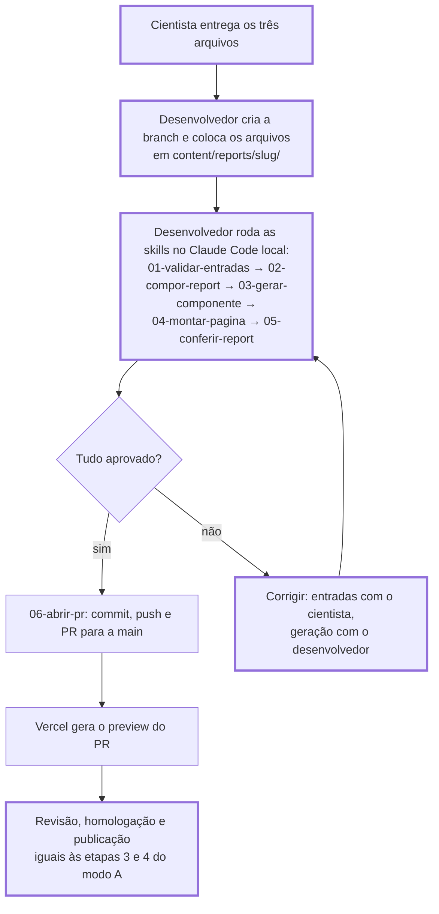

# Fluxo da esteira de publicação de estudos

Como um estudo sai das entradas do cientista e chega à produção. Responde à Q11 do PRD (forma de execução do agente). As etapas do agente são as skills em `.claude/skills/` (ADR-005).

Há dois modos de execução:

- **Modo A, a meta:** a geração roda num workflow do GitHub, dentro do próprio PR do estudo.
- **Modo C, o piloto:** a geração roda numa sessão local do Claude Code, operada pelo desenvolvedor, enquanto o renderizador e as skills amadurecem.

Nos dois modos, cada PR é o ambiente de homologação do seu estudo, pelo preview da Vercel. Não há branch de homologação: o que o stakeholder aprova no preview é exatamente o que vai para a `main` no merge.

## Modo A: geração no PR (meta)

Nos diagramas, as caixas com borda grossa são etapas humanas.

### Regras do modo A

- **Workflows.** `.github/workflows/gerar-estudo.yml` roda o agente com as skills. `.github/workflows/validacao.yml` roda lint, typecheck, `npm run validar` e build em todo PR para a `main`.
- **Gatilho.** A geração roda quando o último push do PR altera `content/reports/<slug>/`, só para os estudos alterados. Commits do próprio agente só alteram `app/reports/<slug>/`, então não disparam uma nova geração.
- **Versões.** Cada geração é um commit no mesmo PR, com um preview novo. As versões anteriores ficam no histórico do PR (PRD, RF-14).
- **Ajustes.** O agente nunca altera as entradas. Ajuste de apresentação é feito por uma pessoa no `guideline.md`; ajuste de análise ou de dados volta para o cientista (ADR-005; PRD, Q23).
- **Publicação.** O merge na `main` é sempre humano. A `main` precisa de proteção para que nada entre sem PR, validação e aprovação (PRD, RF-13 e Q18).
- **Credenciais.** O token do modelo fica em segredo do repositório (RNF-09). O workflow precisa de permissão de escrita no conteúdo e nos PRs.

## Modo C: sessão local (piloto)

No modo C, quem opera as skills é o desenvolvedor, e o PR só é aberto depois que a geração passa na conferência. Os ajustes pedidos na homologação seguem o mesmo caminho, rodando as skills de novo na branch do PR.

## Diferenças entre os modos

| | Modo A (meta) | Modo C (piloto) |
|---|---|---|
| Quem entrega as entradas no repositório | Cientista, pela interface do GitHub | Desenvolvedor |
| Onde o agente roda | Workflow do GitHub, no PR | Claude Code na máquina do desenvolvedor |
| Quando o PR é aberto | Na entrega, antes da geração | Depois da geração aprovada |
| Papel da skill `06-abrir-pr` | Atualizar a descrição do PR existente | Criar a branch e o PR |
| Credenciais no GitHub | Necessárias | Não |
