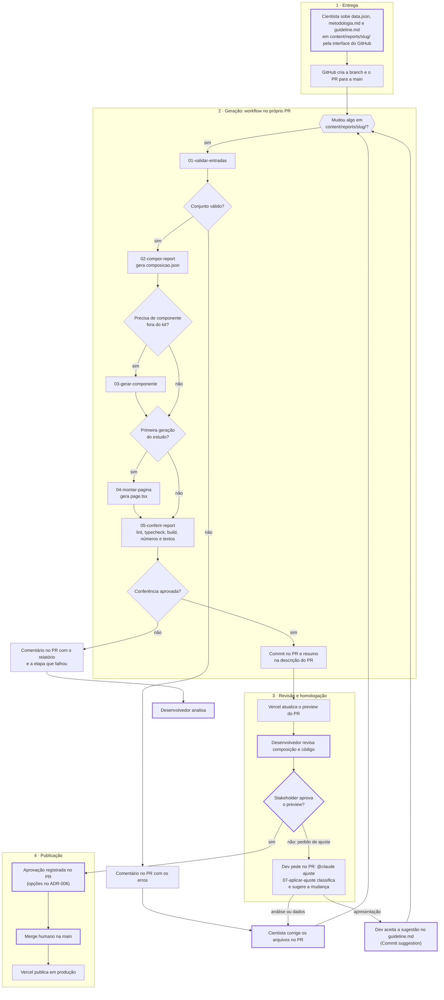
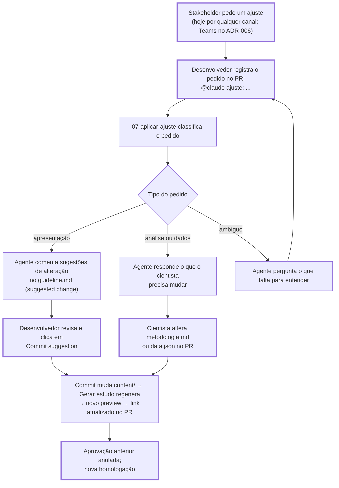
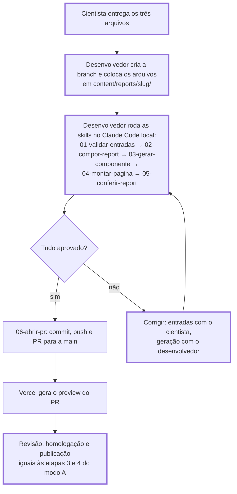

# Fluxo da esteira de publicação de estudos

Como um estudo sai das entradas do cientista e chega à produção. Responde à Q11 do PRD (forma de execução do agente). As etapas do agente são as skills em `.claude/skills/` (ADR-005).

Há dois modos de execução:

- **Modo A, a meta:** a geração roda num workflow do GitHub, dentro do próprio PR do estudo.
- **Modo C, o piloto:** a geração roda numa sessão local do Claude Code, operada pelo desenvolvedor, enquanto o renderizador e as skills amadurecem.

Nos dois modos, cada PR é o ambiente de homologação do seu estudo, pelo preview da Vercel. Não há branch de homologação: o que o stakeholder aprova no preview é exatamente o que vai para a `main` no merge.

## Modo A: geração no PR (meta)

Nos diagramas, as caixas com borda grossa são etapas humanas.



### Regras do modo A

- **Workflows.** `.github/workflows/gerar-estudo.yml` roda o agente com as skills. `.github/workflows/validacao.yml` roda lint, typecheck, `npm run validar` e build em todo PR para a `main`.
- **Gatilho.** A geração roda quando o último push do PR altera `content/reports/<slug>/`, só para os estudos alterados. Commits do próprio agente só alteram `app/reports/<slug>/`, então não disparam uma nova geração.
- **Disparo manual.** Para gerar de novo sem mudar as entradas, por exemplo depois de o kit ganhar um bloco que faltava, rode o workflow à mão (Actions → Gerar estudo → Run workflow) com o número do PR. Sem slugs, gera todos os estudos que o PR altera em `content/reports/`. O PR precisa estar aberto.
- **Versões.** Cada geração é um commit no mesmo PR, com um preview novo. As versões anteriores ficam no histórico do PR (PRD, RF-14).
- **Ajustes.** O agente nunca faz commit nas entradas. Um desenvolvedor pede o ajuste com `@claude` no PR, o agente sugere a mudança no `guideline.md` e o desenvolvedor aceita; ajuste de análise ou de dados volta para o cientista. Passo a passo em [Ajustes pedidos na homologação](#ajustes-pedidos-na-homologação).
- **Publicação.** O merge na `main` é sempre humano. A `main` precisa de proteção para que nada entre sem PR, validação e aprovação (PRD, RF-13 e Q18).
- **Credenciais.** O token do modelo fica em segredo do repositório (RNF-09). O workflow precisa de permissão de escrita no conteúdo e nos PRs.
- **Custo.** Ao fim de cada geração, o workflow registra o custo estimado, os turnos e a duração do agente no resumo da execução e num comentário do PR ("Custo das execuções do agente neste PR"), com uma linha por execução e o total. O `claude.yml` registra só no resumo da execução. Com o token da assinatura, o valor é o custo equivalente pela tabela de preços da API, não uma cobrança (`.github/scripts/custo-do-agente.sh`).
- **Revisão do código gerado.** O agente faz commit como o bot `claude`, e esse commit dispara o `Validação` e a revisão do Claude, que aceita o bot (`allowed_bots`).
- **Homologação.** O preview do PR exige login na Vercel; os stakeholders acessam com a conta criada para eles (ADR-006). O link a enviar é o do comentário "Preview para homologação", que o workflow `link-do-preview.yml` publica no PR a cada deploy, com o endereço completo de cada estudo alterado (`…vercel.app/reports/<slug>`) e o commit da versão. A raiz do preview abre o estudo mais recente, que nem sempre é o do PR.
- **Testado** em 16/10/2026 com um PR real e um estudo fictício: geração de ponta a ponta em cerca de 2 minutos (backlog, V11).

## Ajustes pedidos na homologação

Quando um stakeholder pede uma mudança no preview, o ajuste **nunca é feito na página nem direto na composição**. Ele entra pelas entradas do estudo, e a geração roda de novo sozinha.

**Regra:** o `guideline.md` só muda quando um **desenvolvedor pede explicitamente**. O agente sugere; uma pessoa aceita (ADR-005).



### Passo a passo

1. **O pedido chega.** Hoje, por qualquer canal; quando o ADR-006 for decidido, pelo "Pedir ajuste" do Teams.
2. **Um desenvolvedor registra o pedido no PR**, num comentário que menciona o agente:

   ```
   @claude ajuste: o ranking de regiões deve mostrar só as 3 maiores
   ```

   Só quem tem permissão de escrita no repositório aciona o `@claude`.
3. **O agente classifica o pedido** (skill `07-aplicar-ajuste`):
   - **Apresentação** (gráfico, top N, ordem, títulos, rótulos, destaque): responde com **sugestões de alteração** em cima das linhas do `guideline.md`;
   - **Análise ou dados** (métrica, recorte, número, texto de conclusão): responde o que o cientista precisa mudar na `metodologia.md` ou no `data.json`;
   - **Ambíguo:** pergunta o que falta.
4. **Uma pessoa aplica a mudança.**
   - Apresentação: o desenvolvedor revisa cada sugestão e clica em **Commit suggestion**. Ele também pode editar a sugestão antes, ou recusá-la.
   - Análise ou dados: o cientista altera o arquivo no próprio PR, pelo site do GitHub ou localmente. Se o ajuste muda a análise de forma relevante, a decisão de seguir no mesmo PR ou voltar ao começo ainda está em aberto (PRD, Q23).
5. **A geração roda sozinha.** O commit muda `content/reports/<slug>/`, o `Gerar estudo` regenera a composição e o agente faz o commit. Depois do deploy, a Vercel gera um preview novo e o comentário "Preview para homologação" passa a mostrar o link da nova versão.
6. **Nova homologação.** A proteção da `main` anula a aprovação anterior, e o stakeholder confere a nova versão pelo link atualizado.

### Garantias

- O agente nunca faz commit nas entradas: o workflow `Validação` reprova o PR se um commit de bot alterar `content/`.
- Toda mudança no guideline tem um autor humano no histórico do PR, e cada versão tem o próprio preview (RF-14).
- Uma sugestão só pode ser feita em linhas que mudaram no PR. Num PR de estudo novo, o guideline inteiro é novo, então sempre funciona. Num ajuste de um estudo antigo, o agente responde com o trecho a mudar em texto comum, e o desenvolvedor edita.

## Modo C: sessão local (piloto)



No modo C, quem opera as skills é o desenvolvedor, e o PR só é aberto depois que a geração passa na conferência. Os ajustes pedidos na homologação seguem o mesmo caminho, rodando as skills de novo na branch do PR.

## Diferenças entre os modos

| | Modo A (meta) | Modo C (piloto) |
|---|---|---|
| Quem entrega as entradas no repositório | Cientista, pela interface do GitHub | Desenvolvedor |
| Onde o agente roda | Workflow do GitHub, no PR | Claude Code na máquina do desenvolvedor |
| Quando o PR é aberto | Na entrega, antes da geração | Depois da geração aprovada |
| Papel da skill `06-abrir-pr` | Atualizar a descrição do PR existente | Criar a branch e o PR |
| Credenciais no GitHub | Necessárias | Não |
