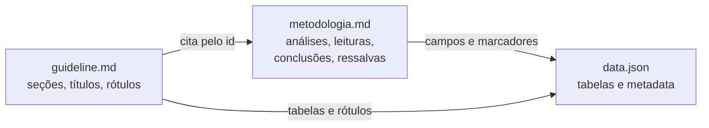

# Guia de preenchimento do conjunto do estudo

Este guia explica como preparar os três arquivos que viram um report no site de estudos. Ele é para quem conduz o estudo e entrega os dados, a metodologia e o guia de montagem.

- Modelos em branco: [`docs/template/`](template/)
- Exemplo completo de um estudo real: [`content/reports/impacto-restricoes-ue/`](../content/reports/impacto-restricoes-ue/)
- Como o conjunto vira report: [`fluxo-da-esteira.md`](fluxo-da-esteira.md)

## 1. O que você entrega

Três arquivos numa pasta com o identificador do estudo (o **slug**):

```
content/reports/<slug>/
  data.json        os dados, já agregados
  metodologia.md   o que é verdade e os textos de análise
  guideline.md     como o report deve ser montado
```

O slug aparece na URL do report (`/reports/<slug>`). Use letras minúsculas, números e hífens, sem acento: `impacto-restricoes-ue`.

## 2. Quem responde por quê

Cada informação vive num só arquivo. Quando bater a dúvida "onde coloco isto?", use esta tabela:

| Arquivo | Responde por | Não responde por |
|---|---|---|
| `data.json` | Os números e nomes exibidos, já calculados; fontes, data de referência e período | Como exibir, o que concluir |
| `metodologia.md` | O que cada análise mede e todo texto de análise: leituras, conclusões e ressalvas | Layout, cores, componentes |
| `guideline.md` | Como o report é montado: seções, ordem, o que destacar, títulos e rótulos | Números, conclusões |

Três regras valem para o conjunto todo:

1. **O report não faz contas.** Todo número exibido já vem pronto no `data.json`, inclusive percentuais, participações e variações.
2. **O agente não escreve textos.** Todo texto do report sai da metodologia (análise) ou do guideline (interface). Se um texto não estiver em nenhum dos dois, ele não aparece.
3. **Nenhum valor dos dados é escrito à mão num texto.** Ele entra como marcador, e o report preenche com o valor do `data.json` (seção 4.3).

## 3. `data.json`

### 3.1 Estrutura

O arquivo tem dois blocos: `metadata`, com o que vale para o estudo inteiro, e `tabelas`, com os dados.

```json
{
  "metadata": {
    "data_referencia": "2026-09-10",
    "periodo": { "inicio": "2025-01", "fim": "2026-07" },
    "fontes": [
      { "nome": "Comex Stat", "referencia": "Exportações brasileiras por NCM, MDIC" }
    ]
  },
  "tabelas": {
    "countries26": {
      "descricao": "Exportações de 2026 por país de destino",
      "chave": ["pais_destino"],
      "campos": {
        "pais_destino": { "tipo": "texto", "descricao": "País de destino na União Europeia" },
        "vl_fob": { "tipo": "numero", "unidade": "US$", "descricao": "Valor FOB exportado" }
      },
      "linhas": [
        { "pais_destino": "Alemanha", "vl_fob": 97032522 },
        { "pais_destino": "Espanha", "vl_fob": 142896577 }
      ]
    }
  }
}
```

| Campo | Obrigatório | O que é |
|---|---|---|
| `metadata.data_referencia` | Sim | Data do snapshot dos dados, `AAAA-MM-DD`. Aparece no rodapé do report como "Elaboração analítica" |
| `metadata.periodo` | Não | Período que os dados cobrem: `inicio` e `fim`, em `AAAA`, `AAAA-MM` ou `AAAA-MM-DD` |
| `metadata.fontes` | Sim | Uma ou mais fontes, cada uma com `nome` e `referencia`. O `nome` aparece no topo ("Base analisada") e no rodapé ("Fonte") |
| `tabelas.<nome>.descricao` | Sim | O que cada linha representa |
| `tabelas.<nome>.chave` | Se a tabela tiver mais de uma linha | Campos que identificam uma linha; não podem se repetir |
| `tabelas.<nome>.campos` | Sim | Cada campo com `tipo`, `descricao` e, se fizer sentido, `unidade` e `nulo` |
| `tabelas.<nome>.linhas` | Sim | As linhas, uma por objeto |

### 3.2 Tipos de campo

| Tipo | Formato do valor | Exemplo |
|---|---|---|
| `texto` | texto | `"Alemanha"` |
| `numero` | número, sem aspas | `97032522` |
| `data` | texto `AAAA-MM-DD` | `"2026-03-15"` |
| `mes` | texto `AAAA-MM` | `"2025-01"` |
| `ano` | número inteiro | `2026` |
| `geo_ponto` | `[latitude, longitude]` | `[-27.59, -48.55]` |
| `geo_linhas` | lista de linhas de `[latitude, longitude]` | `[[[-27.5, -48.5], [-27.6, -48.6]]]` |

Um campo só pode ter valor `null` se tiver `"nulo": true`.

### 3.3 Cuidados

- **Nomes de tabela e de campo:** minúsculas, números e `_`, começando por letra (`vl_fob`, `monthly_state`).
- **Dados já agregados no nível exibido.** Se o report mostra o total de 2026 por país, a tabela já traz uma linha por país com o total.
- **Indicadores soltos** (o total de um ano, o principal destino) ficam numa tabela de uma linha só, como a `summary` do exemplo. Tabela de uma linha não precisa de `chave`.
- **Rótulos limpos.** Entregue os nomes como devem aparecer: `ITAJAI`, e não `0927800 - ITAJAI`. Se vierem sujos, o report limpa e o PR avisa, mas o ideal é que cheguem prontos.
- **Percentuais e variações prontos**, como campos. O report não calcula.
- **Geometria simplificada.** Pontos (`geo_ponto`) e traçados (`geo_linhas`) vão inteiros para a página, que fica tão pesada quanto eles. Simplifique os traçados antes de entregar (por exemplo, Douglas-Peucker com tolerância da ordem de 20 m): o desenho não muda nos zooms do report e o arquivo cai mais de 90% (ADR-007).
- **Só dados que podem ser publicados.** Tudo o que está no `data.json` fica público com o report.

## 4. `metodologia.md`

O arquivo tem um **cabeçalho** entre linhas `---`, em YAML, e um **corpo** em Markdown livre. O cabeçalho é o que o report usa; o corpo explica.

### 4.1 Análises

Cada análise é uma visão do estudo que o report mostra, como um ranking, uma série ou um fluxo. Ela tem um `id`, um `titulo` e as tabelas e campos que usa.

```yaml
analises:
  - id: ranking-destinos
    titulo: Ranking de países de destino
    tabelas:
      countries26:
        campos: [pais_destino, vl_fob, kg_liquido]
```

Os ids usam minúsculas, números e hífens (`ranking-destinos`). É por eles que o guideline cita cada análise.

### 4.2 Leituras, conclusões e ressalvas

São os textos de análise do report. Cada um tem um `id` e um `texto`.

| Tipo | Quando usar | Ligação com análise |
|---|---|---|
| `leituras` | Textos que não são conclusão: apresentação, como interpretar, mensagem-chave e textos curtos, como o detalhe de um indicador ("Volume potencialmente exposto") ou uma informação do topo ("2026" no recorte principal) | Opcional |
| `conclusoes` | Afirmações que o estudo sustenta | Obrigatória (`analise`) |
| `ressalvas` | Limites e cuidados de leitura | Opcional; todas aparecem no report |

```yaml
leituras:
  - id: como-interpretar
    texto: "Os resultados representam exportações históricas incluídas no recorte."
ressalvas:
  - id: redirecionamento
    texto: "Os fluxos podem ser redirecionados para outros mercados."
```

**O texto vai sempre entre aspas.** Sem aspas, um dois-pontos ou uma chave `{` no texto quebram o arquivo.

### 4.3 Marcadores: valores dos dados dentro do texto

Todo número ou nome que vem dos dados entra no texto como **marcador**, um nome entre chaves. Para cada marcador, `valores` diz de onde vem o valor e como exibi-lo:

```yaml
conclusoes:
  - id: prioridade-mercado-origem
    analise: exposicao-2026
    texto: "Em 2026, {pais} é o principal mercado no recorte, com {fob_pais}."
    valores:
      - id: pais
        tabela: summary
        campo: top_country
        formato: texto
      - id: fob_pais
        tabela: summary
        campo: top_country_fob
        formato: fob
```

O report exibe: *"Em 2026, Países Baixos (Holanda) é o principal mercado no recorte, com US$ 637,6 mi."*

- **`filtro`** escolhe a linha quando a tabela tem várias: `filtro: { pais_destino: Alemanha }`. Ele precisa selecionar exatamente uma linha. Sem filtro, a tabela precisa ter uma linha só.
- **`formato`** define a exibição:

| Formato | Para campo do tipo | Exemplo |
|---|---|---|
| `texto` | qualquer | `Países Baixos (Holanda)` |
| `compact` | número | `271344120` → `271,3 mi` |
| `inteiro` | número | `24651` → `24.651` |
| `decimal` | número | `871.06` → `871,1` |
| `fob` | número em dólar | `1132620598` → `US$ 1,1 bi` |
| `cleanLabel` | texto | `0927800 - ITAJAI` → `ITAJAI` |

Números que não vêm dos dados, como o ano de um recorte ou "os 10 maiores", podem ser escritos direto no texto.

**Negrito.** Um trecho entre `**` sai em negrito no report: `"Os dados vêm do **Plano Nacional de Logística**."`. Pode envolver marcadores: `"**{extensao}** estão acima de 70%."`.

### 4.4 Corpo

Explique as fontes, como cada análise é feita (fórmulas, unidades, recortes, filtros, campos a usar e a evitar), o contexto das leituras e conclusões e o detalhe das ressalvas. **Cada análise do cabeçalho precisa de uma subseção `###` em `## Análises`, com o mesmo título.**

## 5. `guideline.md`

Também tem cabeçalho YAML e corpo livre. O guideline diz **como** o report é montado e traz os **textos de interface**: títulos, introduções e rótulos. Ele não traz números, nomes vindos dos dados nem conclusões.

Um texto que tenha dois-pontos seguido de espaço precisa ir entre aspas, senão o arquivo quebra: `intro: "Três camadas: origem, saída e destino."`. Na dúvida, use aspas.

### 5.1 Identificação

```yaml
slug: impacto-restricoes-ue
sobretitulo: Análise de comércio exterior · União Europeia     # opcional
titulo: Impacto da suspensão das importações ...
subtitulo: Um retrato dos fluxos comerciais potencialmente expostos ...
seo:
  titulo: Impacto das restrições da União Europeia | GRAF Infra Consulting   # opcional
  descricao: Até 160 caracteres para buscadores.
meta:                                  # opcional; itens extras do topo
  - rotulo: Recorte principal
    leitura: recorte-principal         # leitura da metodologia com o texto "2026"
```

Fonte e período aparecem no topo automaticamente, a partir do `metadata` do `data.json`.

### 5.2 Tabelas e rótulos

- `tabelas`: as tabelas e campos do `data.json` que o report usa.
- `rotulos`: o nome exibido de cada campo que aparece em eixo, legenda, controle ou cartão (`vl_fob: Valor FOB`).

### 5.3 Seções

As seções aparecem na ordem da lista. Cada uma cita, pelo id, o que mostra da metodologia:

```yaml
secoes:
  - id: mercados-e-origens
    sobretitulo: Mercados e origens                  # opcional
    titulo: Países consumidores e estados de origem  # opcional
    intro: Rankings por valor FOB em 2026 ...        # opcional
    analises:
      - id: ranking-destinos
        titulo: Países de destino                    # título do gráfico, opcional
        descricao: Principais consumidores europeus por valor FOB.
    conclusoes:
      - id: prioridade-mercado-origem
        titulo: Leitura prioritária                  # abertura em negrito da caixa, opcional
        tipo: destaque                               # estilo da caixa, opcional
    leituras: [como-interpretar]                     # opcional
    ressalvas: [redirecionamento]                    # opcional
```

**Cartões de indicadores.** Para mostrar números soltos em cartões, liste-os em `indicadores` dentro da análise. O nome do cartão vem de `rotulos`, o valor vem do `data.json` e o texto abaixo do valor vem de uma leitura da metodologia:

```yaml
    analises:
      - id: exposicao-2026
        indicadores:
          - campo: kg_2026
            detalhe: detalhe-kg-2026      # leitura "Volume potencialmente exposto"
```

**Ressalvas.** Toda ressalva da metodologia aparece no report. Se o guideline citar a ressalva numa seção, ela aparece ali; se não citar e ela estiver ligada a uma análise, aparece na seção dessa análise; sem análise ligada, aparece ao final.

### 5.4 Visual e componentes novos

- `visual` (opcional): a intenção visual em poucas palavras, como "barras horizontais com os 10 maiores" ou "destinos e origens lado a lado".
- `componentes_novos`: deixe `[]` se o kit atende. Se o estudo precisar de algo que o kit não tem, descreva `nome`, `motivo`, `comportamento` e `tabelas`.

### 5.5 Corpo

Uma seção `##` por seção do cabeçalho, com o id como título, dizendo o que mostrar, o que destacar, que comparação fazer e que controles o leitor tem (por exemplo, "o leitor alterna entre valor FOB e peso líquido; começa em valor FOB").

## 6. Como as peças se ligam



A validação confere cada uma dessas ligações. Se um id, tabela ou campo citado não existir, o conjunto é recusado com a indicação do arquivo e do lugar.

## 7. Erros mais comuns

| Erro | Exemplo da mensagem |
|---|---|
| Campo citado que não existe | `guideline.md · tabelas: campo "countries26.peso" não existe no data.json` |
| Id citado que não existe | `guideline.md · secoes.mercados-e-origens.conclusoes: "prioridade-mercado" não existe na metodologia` |
| Marcador sem valor | `metodologia.md · conclusoes.prioridade-mercado-origem: marcador {fob_uf} sem item em valores` |
| Número escrito à mão | `metodologia.md · conclusoes.prioridade-mercado-origem: número "637,6" escrito no texto; use um marcador` |
| Filtro que pega várias linhas | `o filtro seleciona 26 linhas; deve selecionar 1` |
| Formato incompatível | `formato "fob" incompatível com o tipo texto` |
| Valor fora do tipo | `data.json · tabelas.monthly_product.linhas[0].periodo: valor "jan/2025" não segue o tipo mes` |
| Chave repetida | `data.json · tabelas.countries26.linhas[26]: chave repetida ["Alemanha"]` |
| Análise sem explicação no corpo | `metodologia.md · corpo: análise "ranking-origens" sem subseção "### Ranking de estados de origem"` |
| SEO longo demais | `.seo.descricao should NOT be longer than 160 characters` |

## 8. Antes de entregar

Se você tiver o projeto instalado na sua máquina, rode `npm run validar -- <slug>`. O comando faz todas as checagens desta lista e das seções anteriores e mostra cada erro com o arquivo e o lugar. Se não tiver, quem roda é o desenvolvedor, na entrega.

- [ ] A pasta e o `slug` do guideline têm o mesmo nome.
- [ ] O `data.json` tem `metadata` (data de referência e fontes) e `tabelas`, cada uma com descrição, campos tipados e linhas.
- [ ] Todo número exibido está pronto no `data.json`, inclusive percentuais.
- [ ] Os rótulos de texto estão limpos, sem códigos e sem vazios.
- [ ] Toda análise do cabeçalho da metodologia tem sua subseção no corpo.
- [ ] Todo texto da metodologia está entre aspas, e todo valor dos dados nele é um marcador com item em `valores`.
- [ ] Toda seção do guideline cita só ids que existem na metodologia.
- [ ] Todo campo exibido em eixo, controle ou cartão tem nome em `rotulos`.
- [ ] Os textos do guideline não trazem números dos dados nem conclusões.

## 9. Como entregar

- **Hoje (piloto):** envie os três arquivos ao desenvolvedor responsável pela plataforma. Ele coloca os arquivos no repositório, roda a geração e abre o PR com o preview.
- **Meta:** você mesmo envia os arquivos pelo GitHub, em "Add file → Upload files", dentro de `content/reports/<slug>/`, criando uma branch e um PR. A geração roda no PR e o preview fica pronto ali.

Depois da entrega, confira no preview se o report expressa a análise, pelo link do comentário "Preview para homologação" no PR. Ajustes de apresentação entram no `guideline.md`, pedidos por um desenvolvedor no PR; ajustes de análise ou de dados, na `metodologia.md` ou no `data.json`, feitos por você. O report é gerado de novo a cada mudança. O passo a passo está no [fluxo da esteira](fluxo-da-esteira.md#ajustes-pedidos-na-homologação).
